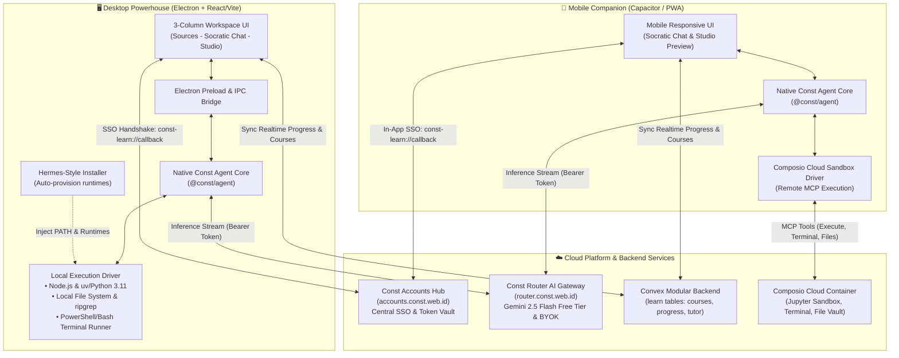
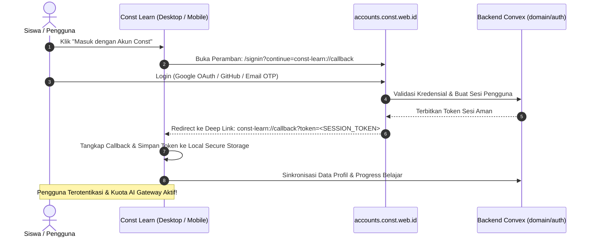
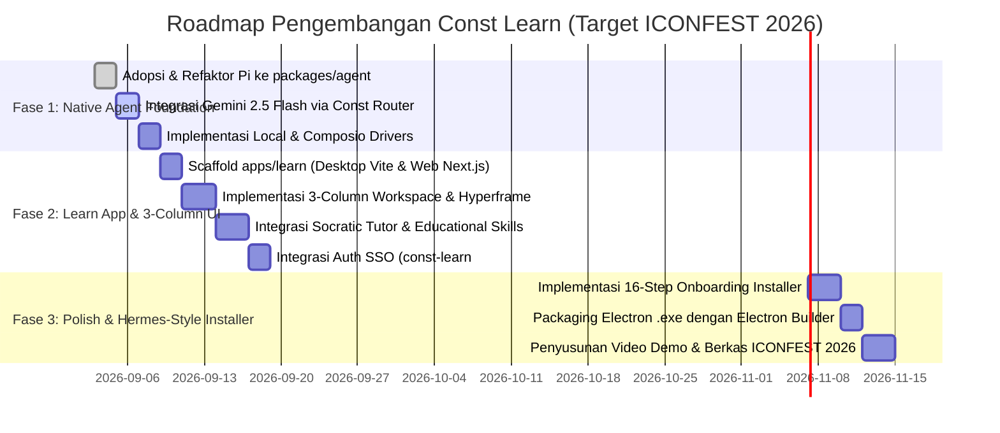

# Arsitektur Sistem: Const Learn (EduTech Platform & Native Agent)

Dokumen ini merupakan cetak biru resmi (_master architecture blueprint_) untuk **Const Learn**, pilar produk utama dalam ekosistem **Const Platform** yang dirancang khusus sebagai karya utama kompetisi **ICONFEST 2026 (Kategori Software Development - Tema Pendidikan)**.

---

## 1. Ringkasan Eksekutif & Visi Produk

**Const Learn** adalah platform *Actionable AI Research, Native Learning Agent, & Interactive Learning Hub*. Berbeda dengan chatbot pembelajaran pasif biasa, Const Learn menggabungkan kenyamanan riset multi-dokumen adaptif (ala NotebookLM), bimbingan tutor interaktif (metode Socrates), **Single Native Agent Engine** berkemampuan manipulasi kode dan data secara nyata, serta kanvas interaktif **Hyperframe** untuk memproduksi materi belajar (slide presentasi, diagram interaktif, hingga visualisasi matematika/data).

### Visi Utama untuk ICONFEST 2026:
1. **Pendidikan Berkeadilan & Zero-Config:** Setiap siswa langsung mendapatkan akses ke model cerdas **Google Gemini 2.5 Flash** secara gratis melalui kuota harian terkelola di **Const Router** (`router.const.web.id`) tanpa perlu memiliki kartu kredit atau API key sendiri.
2. **Dual-Tier Architecture:** Performa maksimal di PC/Laptop dengan eksekusi lokal tanpa batas (*Desktop Powerhouse*), dipadukan dengan kemudahan akses di smartphone (*Mobile Companion*) melalui sandbox awan.
3. **Pengalaman Pengguna Tanpa Hambatan (Hermes-Style Onboarding):** Pemasangan dependensi teknis (Python, uv, Node.js, ffmpeg) ditangani 100% otomatis oleh wizard installer ramah pemula.
4. **Single Identity Ecosystem:** Autentikasi dan sesi terpusat di `accounts.const.web.id` dengan integrasi deep linking instan.

---

## 2. Topologi Arsitektur Klien: Dual-Tier Strategy

Const Learn memecahkan dilema klasik aplikasi agentic (keterbatasan sandbox OS mobile vs kekuatan penuh desktop) melalui pendekatan arsitektur klien dua tingkat (*Dual-Tier Execution*):



---

## 3. Native Agent Engine: Single Official Engine (`packages/agent`)

Menghilangkan kompleksitas membungkus berbagai CLI pihak ketiga (*No Meta-Agent Harness*), Const Learn mengusung **1 Single Native Agent Engine** bernama **Const Agent** yang diadopsi dan direfaktor dari fondasi arsitektur bersih **Pi** (`D:\Code\Clone\pi` karya Mario Zechner).

### A. Alasan Pemilihan Arsitektur Pi
* **Zero Bloat & Tanpa Framework Eksotis:** Berbeda dengan DeepSeek-Harness yang bergantung pada Cordis framework (49 paket) atau OpenCode yang terikat pada paradigma Effect-TS dan SST cloud, Pi ditulis dengan **Modern TypeScript murni** berbasis standar Node.js/Bun.
* **Protokol RPC Native (`@pi/client` & `@pi/server`):** Memiliki antarmuka JSON-RPC teruji yang memungkinkan antarmuka desktop (Electron) berkomunikasi langsung dengan proses agen melalui event-streaming (`session.subscribe`).
* **Multi-Provider Andal (`@pi/ai`):** Mendukung Google Gemini (`@google/genai`), OpenAI, Anthropic, DeepSeek, OpenRouter, dan custom `baseURL` secara bawaan.
* **Fitur Bawaan Lengkap:** Telah menyertakan parser skill modular (`skills.ts`), eksekutor perintah aman (`bash-executor.ts`), gerbang persetujuan (*Approval Gate* via `trust-manager.ts`), dan kompresi konteks riwayat obrolan (*compaction*).

### B. Abstraksi Driver Eksekusi: Local vs Cloud

Const Agent menggunakan antarmuka abstraksi `ExecutionDriver` tunggal. Agen tidak peduli apakah ia berjalan di laptop atau smartphone; logika agen tetap sama, hanya driver eksekusinya yang berganti:

```typescript
export interface ExecutionDriver {
  executeCommand(cmd: string): Promise<CommandResult>;
  readFile(path: string): Promise<string>;
  writeFile(path: string, content: string): Promise<void>;
  executePython(code: string): Promise<PythonResult>;
}
```

1. **`LocalExecutionDriver` (Desktop):**
   - Menjalankan perintah melalui shell lokal (PowerShell / Bash).
   - Membaca/menulis file langsung ke folder proyek siswa di hard disk.
   - Menjalankan skrip Python lokal melalui runtime `uv` / Python virtualenv.
2. **`ComposioSandboxDriver` (Mobile):**
   - Menghubungkan agen ke **Composio Cloud Code Interpreter MCP** melalui 5 alat:
     * `Create Sandbox`: Mengalokasikan container Linux/Jupyter di awan.
     * `Execute Code`: Menjalankan kode Python dan merender grafik/tabel.
     * `Get File`: Mengambil file dari direktori `/home/user`.
     * `Run Terminal Command`: Mengeksekusi instruksi shell Linux container.
     * `Upload File`: Mengirimkan berkas latihan/kode ke lingkungan sandbox.

---

## 4. Desktop Onboarding Wizard: Hermes-Style Self-Bootstrapping Installer

Untuk memberikan pengalaman terbaik bagi pengguna awam, installer Desktop Const Learn mengadopsi mekanisme *First-Run Self-Bootstrapping Onboarding* yang terinspirasi dari **Hermes Agent**.

```text
┌─────────────────────────────────────────────────────────────┐
│ 🪟 Hermes / Const Learn Agent                               _ □ ✕ │
├─────────────────────────────────────────────────────────────┤
│                                                             │
│                      CONST LEARN AGENT                      │
│                                                             │
│       Agen edukasi adaptif pintar untuk riset & koding.     │
│        Kami akan menyiapkan sistem Anda di latar belakang.   │
│                                                             │
│                         [ INSTALL ]                         │
│                                                             │
└─────────────────────────────────────────────────────────────┘
```

Saat pengguna menekan tombol `[ INSTALL ]`, aplikasi menampilkan proses instalasi transparan 16 langkah:

```text
┌─────────────────────────────────────────────────────────────┐
│ 🪟 Setting up Const Learn Agent                             _ □ ✕ │
├─────────────────────────────────────────────────────────────┤
│  Menyiapkan Lingkungan Belajar Const                         │
│  Langkah ini hanya dilakukan satu kali. Penggunaan          │
│  berikutnya akan langsung masuk ke ruang belajar.            │
│                                                             │
│  4 dari 16 langkah selesai                               35% │
│  ██████████████░░░░░░░░░░░░░░░░░░░░░░░░░░░░░░░░░░░░░░░░░░░░  │
│                                                             │
│  ✓ Installing uv package manager                      (1.2s)│
│  ✓ Installing Git runtime portabel                    (3.4s)│
│  ✓ Detecting Node.js runtime                          (0.5s)│
│  ⟳ Installing ripgrep and ffmpeg                      (in progress)
│    Verifying Python 3.11                                    │
│    Creating Python virtual environment (.venv)              │
│    Installing Python education packages (numpy, matplotlib) │
│    Building local workspace cache                           │
│    Adding Const to User PATH                                │
│    Writing initial configuration templates                  │
│                                                             │
│  [📄 Tampilkan detail >]                          [ Batal ]  │
└─────────────────────────────────────────────────────────────┘
```

### Rincian 16 Langkah Persiapan Lingkungan:
1. **Installing `uv` Package Manager:** Mengunduh binary mandiri `uv` (manajer Python berbasis Rust yang sangat cepat).
2. **Installing Git Portabel:** Memastikan perintah Git tersedia untuk kloning repositori materi.
3. **Detecting Node.js:** Memeriksa keberadaan Node.js `>= 20`. Jika belum ada, mengunduh runtime portabel.
4. **Installing `ripgrep`:** Memasang binary `rg` portabel untuk kemampuan pencarian kode dan materi instan.
5. **Installing `ffmpeg`:** Memasang binary portabel untuk mendukung kompilasi multimedia dan video HyperFrames.
6. **Verifying Python 3.11:** Menjalankan `uv python install 3.11` untuk memasang versi Python yang kompatibel tanpa mengotori instalasi global OS.
7. **Creating Python Virtual Environment:** Menginisialisasi virtualenv lokal di `%APPDATA%/ConstLearn/.venv`.
8. **Installing Python Dependencies:** Mengunduh pustaka esensial edukasi (`matplotlib`, `pandas`, `numpy`, `jupyter_client`).
9. **Installing Local Agent Drivers:** Memverifikasi ketersediaan driver `@const/agent`.
10. **Setting up SQLite Vector Store:** Menyiapkan basis data lokal untuk pencarian semantik dokumen PDF siswa.
11. **Configuring Sandboxed IPC Bridge:** Mengaktifkan jembatan komunikasi aman antara antarmuka Electron dan agen lokal.
12. **Adding Const CLI to PATH:** Memasang alias `const` ke variabel `PATH` pengguna.
13. **Writing Configuration Templates:** Membuat berkas konfigurasi awal `~/.const/config.json`.
14. **Pre-caching Default Education Skills:** Mengekstrak modul *Socratic Tutor*, *Slide Generator*, dan *D3 Visualizer*.
15. **Verifying Health & Ping Test:** Melakukan uji coba konektivitas ke `router.const.web.id`.
16. **Finalizing Workspace:** Menghapus berkas temporer instalasi dan membuka antarmuka utama.

> [!IMPORTANT]
> **Jadwal Pembangunan Installer:**
> Seluruh wizard installer ini **dibangun pada FASE AKHIR (Packaging & Distribution)** setelah:
> 1. Core Native Agent (`packages/agent`) selesai dan teruji.
> 2. Antarmuka Desktop & fitur-fitur belajar (`apps/learn`) berjalan sempurna dalam mode pengembangan (`pnpm dev`).
> Pendekatan ini menjaga efisiensi proses pengembangan dan mencegah pemborosan waktu build berulang kali di awal.

---

## 5. Model AI Default & Integrasi Const Router

Setiap pengguna Const Learn mendapatkan alur akses model cerdas yang terintegrasi:

1. **Default Mode (Free Edu Tier):**
   - Mengarah langsung ke `https://router.const.web.id/api/v1`.
   - Menggunakan model default **Google Gemini 2.5 Flash** (kecepatan respons tinggi, penalaran logis tajam, dan jendela konteks luas).
   - Pengguna masuk (*login*) menggunakan akun Const dari `accounts.const.web.id`. Router secara otomatis memberikan kuota token harian gratis tanpa perlu input kartu kredit.
2. **BYOK (Bring Your Own Key):**
   - Pengguna tingkat lanjut dapat memasukkan API Key pribadi (OpenAI GPT-4o, Anthropic Claude 3.7 Sonnet, DeepSeek V3, Groq) atau endpoint kustom (Ollama lokal `http://localhost:11434/v1`, vLLM, OpenRouter).
   - Permintaan BYOK diteruskan langsung (*direct proxy*) tanpa memotong kuota harian platform.

---

## 6. Autentikasi Terpusat (Central Identity Provider)

Sistem otentikasi Const Learn terhubung penuh dengan **Const Accounts Hub** (`apps/accounts`):



---

## 7. Modular Skills System (Kurasi Open-Design)

Const Learn menerapkan sistem skill berbasis berkas `SKILL.md` (YAML frontmatter + instruksi terstruktur) yang dimuat secara dinamis oleh Const Agent:

1. **Socratic AI Tutor (`socratic-tutor`):** Membimbing siswa dengan pertanyaan pemantik dan penalaran terpandu alih-alih langsung memberikan jawaban instan (*active recall learning*).
2. **Slide Generator (`slides`):** Menyusun materi rangkuman menjadi format presentasi HTML modern yang responsif.
3. **PPTX / Google Slides Exporter (`pptx-generator`):** Mengekspor materi presentasi ke format PowerPoint standar industri.
4. **Interactive Artifacts Builder (`artifacts-builder`):** Menghasilkan mini-aplikasi interaktif atau simulator logika berbasis HTML/JS/Tailwind yang langsung dapat dimainkan di kanvas.
5. **D3 Data Visualization (`d3-visualization`):** Memvisualisasikan data riset, fungsi matematika kalkulus, atau struktur grafik jaringan secara interaktif.
6. **Doc Kami Parchment (`doc-kami-parchment`):** Mengompilasi hasil riset komprehensif menjadi dokumen akademik terstruktur siap cetak.

---

## 8. Antarmuka Desktop: 3-Column Workspace & Hyperframe Canvas

```text
┌─────────────────────────────────────────────────────────────────────────────┐
│ 🪟 Const Learn — Studio Workspace                                    _ □ ✕ │
├───────────────┬──────────────────────────────────┬──────────────────────────┤
│ 📚 SUMBER &   │ 💬 SOCRATIC TUTOR & AGENT STREAM │ 🎨 HYPERFRAME CANVAS     │
│   DOKUMEN     │                                  │    & LIVE TERMINAL       │
├───────────────┼──────────────────────────────────┼──────────────────────────┤
│ • Diktat.pdf  │ [DeepThinking]                   │ [Tab: Canvas Preview]    │
│ • Jurnal.pdf  │ "Menganalisis konsep hukum II     │ ┌──────────────────────┐ │
│ • Web Search  │  Termodinamika pada bab 4..."    │ │  Interactive Heat    │ │
│               │                                  │ │  Engine Simulator   │ │
│ [+ Tambah     │ Tutor:                           │ └──────────────────────┘ │
│    Sumber]    │ "Bagaimana hubungan antara       │                          │
│               │  entropi sistem dengan efisiensi │ [Tab: Live Terminal]     │
│               │  mesin Carnot?"                  │ $ python simulate.py     │
│               │                                  │ [Approval Gate: Approve] │
│               │ [Kotak Pesan Siswa...]           │                          │
├───────────────┴──────────────────────────────────┴──────────────────────────┤
│ ⚙️ Status: Terhubung ke router.const.web.id | Model: Gemini 2.5 Flash (Gratis)│
└─────────────────────────────────────────────────────────────────────────────┘
```

1. **Kolom Kiri (Sources Panel):** Pengunggahan dokumen materi lokal (PDF, Markdown, ePub) dan pencarian referensi web cerdas via Exa.ai.
2. **Kolom Tengah (Conversation Stream):** Bimbingan belajar Socrates, visualisasi proses berpikir (*DeepThinking breakdown*), dan pelacakan langkah agen.
3. **Kolom Kanan (Studio & Terminal):** Kanvas render langsung (*Hyperframe*) untuk melihat hasil slide, grafik D3, atau dokumen akademik, serta terminal interaktif dengan gerbang persetujuan (*Human-in-the-Loop Approval Gate*).

---

## 9. Struktur Direktori Proyek

```text
Const/
├── apps/
│   ├── accounts/                      # Identity Provider & SSO Hub (accounts.const.web.id)
│   ├── router/                        # AI Gateway & Quota Manager (router.const.web.id)
│   ├── landing/                       # Ecosystem Landing Showcase (const.web.id)
│   │
│   └── learn/                         # [CONST LEARN WORKSPACE]
│       ├── arsitektur.md              # Blueprint arsitektur resmi aplikasi Learn
│       ├── desktop/                   # Electron App + React/Vite + Tailwind
│       │   ├── electron/
│       │   │   ├── main.ts            # Window manager, Deep link protocol handler
│       │   │   ├── preload.ts         # Secure IPC bridge
│       │   │   └── installer/         # Hermes-style 16-step onboarding wizard
│       │   └── src/                   # 3-Column UI & Hyperframe Canvas
│       ├── mobile/                    # PWA / Capacitor App (Composio MCP Driver)
│       └── web/                       # Web Learning Portal (learn.const.web.id)
│
├── packages/
│   ├── agent/                         # [NATIVE CONST AGENT ENGINE] (Adopsi Bersih dari Pi)
│   │   ├── core/                      # Agent loop, state machine, trust-manager (approval gate)
│   │   ├── ai/                        # Unified provider SDKs (Gemini default, OpenAI, BYOK)
│   │   ├── drivers/                   # Execution drivers: LocalDriver (Desktop) & ComposioDriver (Mobile)
│   │   ├── skills/                    # Skill parser & dynamic loader (SKILL.md)
│   │   └── client/                    # RPC Client untuk streaming event ke UI
│   │
│   ├── backend/                       # Single Unified Convex Backend (domain-driven: learn/, auth/, router/)
│   ├── ui/                            # Const Design System (@const/ui)
│   └── typescript-config/
```

---

## 10. Roadmap Implementasi Terpadu


