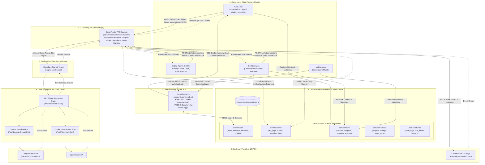
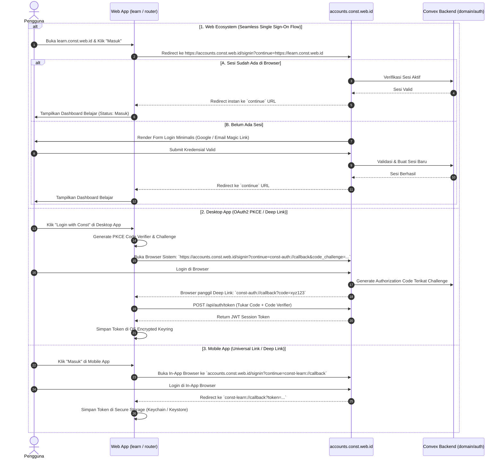
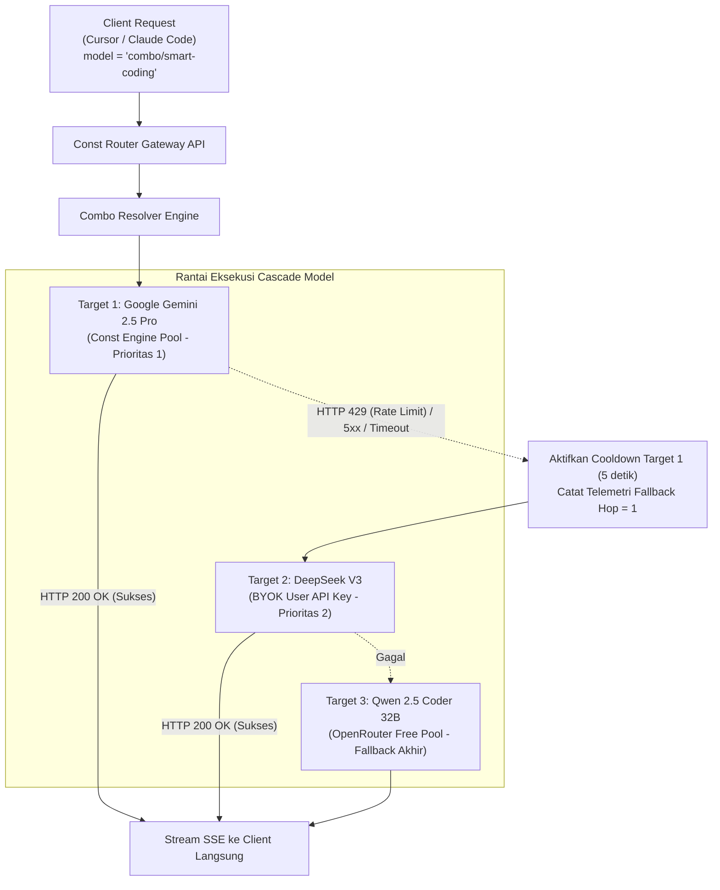
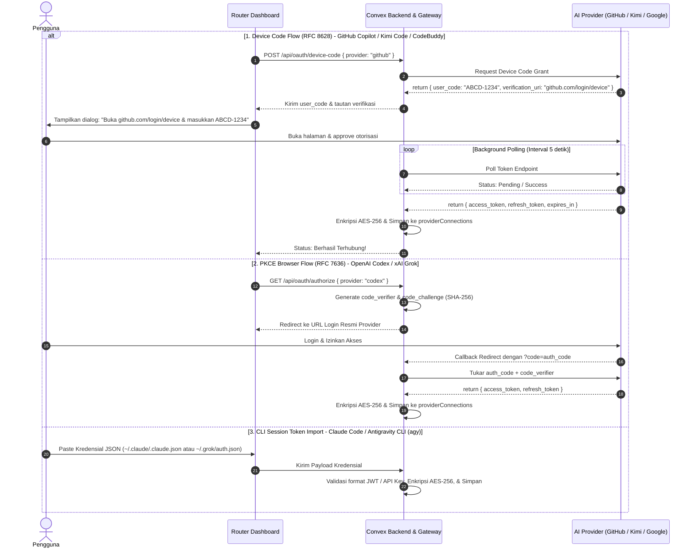
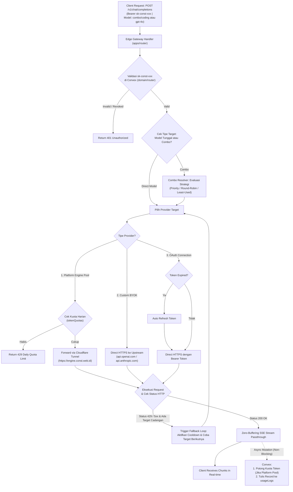
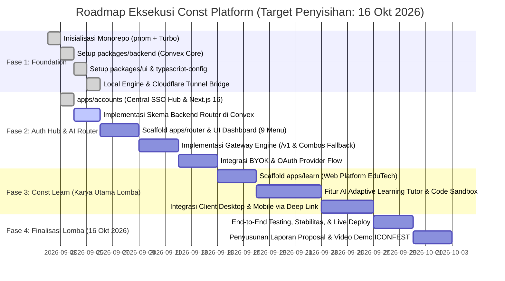

# Arsitektur Sistem: Const Platform Ecosystem

Dokumen ini merupakan cetak biru (_master blueprint_) arsitektur terpadu, topologi sistem, spesifikasi modular monorepo, arsitektur backend Convex berbasis domain (_Domain-Driven Design_), mekanisme otentikasi terpusat (SSO Multi-Platform), AI Gateway (BYOK & Multi-Provider), serta strategi kompetisi **ICONFEST 2026 (Software Development - Tema Pendidikan)** untuk ekosistem **Const Platform**.

---

## 1. Ringkasan Eksekutif & Visi Ekosistem

**Const Platform** adalah ekosistem digital modern terpadu berbasis **Monorepo (Turborepo + pnpm)** yang dirancang dengan prinsip arsitektur tingkat _enterprise_ (_Scalable, Maintainable, Type-Safe, & Modular_).

Ekosistem ini terdiri dari beberapa pilar utama:

1. **Const Accounts (`accounts.const.web.id`):** Identity Provider & Central Auth Hub terpusat yang melayani Web SSO (Cross-Subdomain Cookie), Desktop App (OAuth2 PKCE / Deep Link), dan Mobile App.
2. **Const Router (`router.const.web.id`):** AI Gateway independen berperforma tinggi yang kompatibel dengan standar OpenAI API. Mendukung multi-provider, token metering, rate limiting, serta fitur **BYOK (Bring Your Own Key)** dan integrasi ke local engine (OmniRoute).
3. **Const Engine (`engine.const.web.id`):** Local aggregator tier (OmniRoute di Arch Linux) yang menghubungkan multi-akun AI (6x Google Gemini Pro + OpenRouter) melalui Cloudflare Tunnel berkecepatan tinggi.
4. **Const Learn (`learn.const.web.id` + Desktop/Mobile):** Platform edukasi adaptif berbasis AI interaktif (**Karya Utama ICONFEST 2026 - Tema Pendidikan**).
5. **Const Landing (`const.web.id`):** Portal showcase dan navigasi publik ekosistem.
6. **Const Harness (`harness.const.web.id` + Desktop):** Platform _developer tools_ dan _agentic workbench_ di masa depan.

Seluruh data dan logika bisnis dipusatkan pada **Single Unified Modular Backend (Convex)** dengan arsitektur sub-folder modular (_Domain-Driven Architecture_) untuk mencegah tumpukan file (_flat anti-pattern_) serta menjamin sinkronisasi data _real-time_ instan dan _end-to-end type-safety_.

---

## 2. Topologi & Diagram Arsitektur Terpadu



---

## 3. Struktur Monorepo Terstandar (Turborepo + pnpm)

Monorepo diorganisasikan dengan prinsip **Separation of Concerns (SoC)** dan **High Reusability**:

```text
Const/
├── package.json                      # Root scripts (build, dev, lint, test)
├── pnpm-workspace.yaml               # Definisi workspace packages & apps
├── turbo.json                        # Turborepo task pipeline & caching rules
├── .gitignore
├── README.md
├── arsitektur.md                     # Dokumen master blueprint arsitektur sistem
│
├── packages/                         # Shared Packages (Modul yang dapat dipakai ulang)
│   ├── backend/                      # Single Unified Convex Backend (Modular Architecture)
│   │   ├── package.json
│   │   ├── tsconfig.json
│   │   └── convex/
│   │       ├── schema.ts             # Root schema aggregator
│   │       ├── schema/               # Definisi tabel terpisah per domain
│   │       │   ├── auth.ts           # Schema: users, sessions, profiles, accounts
│   │       │   ├── router.ts         # Schema: api_keys, token_quotas, byok_configs, usage_logs
│   │       │   ├── learn.ts          # Schema: courses, modules, lessons, user_progress, submissions
│   │       │   └── harness.ts        # Schema: harness_workspaces, configs
│   │       ├── auth/                 # Business logic & mutasi Auth Hub
│   │       │   ├── actions.ts        # OAuth external handlers
│   │       │   ├── mutations.ts      # User register, login, session creation
│   │       │   └── queries.ts        # getUser, validateSession, checkRedirect
│   │       ├── router/               # Business logic & mutasi AI Gateway
│   │       │   ├── keys.ts           # API Key creation (sk-const-xxx), revoke, list
│   │       │   ├── quotas.ts         # Token deduct, rate limit checker
│   │       │   └── telemetry.ts      # Usage history & cost metrics
│   │       ├── learn/                # Business logic EduTech (ICONFEST 2026 Core)
│   │       │   ├── courses.ts        # Course & module queries
│   │       │   ├── progress.ts       # Track milestones, quiz submissions
│   │       │   └── tutor.ts          # AI interactive learning feedback & hints
│   │       ├── harness/              # Workbench functions
│   │       │   └── workspaces.ts
│   │       ├── shared/               # Shared backend utilities
│   │       │   ├── rateLimiter.ts
│   │       │   ├── permissions.ts
│   │       │   └── validators.ts
│   │       └── _generated/           # Auto-generated typed API definitions
│   │
│   ├── ui/                           # Const Design System (Shared Component Library)
│   │   ├── package.json
│   │   ├── tsconfig.json
│   │   ├── src/
│   │   │   ├── components/           # Radix / shadcn/ui (Button, Input, Card, Modal, Table, etc.)
│   │   │   ├── layout/               # Header, Navbar, Footer, UserMenu, EcosystemDrawer
│   │   │   ├── theme/                # ThemeProvider (Dark/Light/System)
│   │   │   └── lib/                  # cn, cva, utils
│   │   └── tailwind.config.ts        # Shared Tailwind preset
│   │
│   ├── typescript-config/            # Base TSConfig (@const/typescript-config: base, nextjs, react-library)
│   │   ├── package.json
│   │   ├── base.json
│   │   ├── nextjs.json
│   │   └── react-library.json
│   │
│   └── (Catatan: @const/types ditiadakan karena Convex menyediakan End-to-End Type Safety otomatis
│        langsung via `convex/_generated/`, mencegah duplikasi dan over-engineering)
│
└── apps/                             # Deployable Applications (Next.js 16 App Router)
    ├── accounts/                     # accounts.const.web.id (Central Identity Provider & SSO Hub)
    │   ├── package.json
    │   ├── next.config.ts
    │   └── src/                      # Next.js 16 App Router (Central Login, OAuth, SSO Callback)
    │
    ├── router/                       # router.const.web.id (AI Gateway API & Dashboard)
    │   ├── package.json
    │   ├── next.config.ts
    │   └── src/                      # API /v1/chat/completions + Dashboard API Key Management
    │
    ├── learn/                        # learn.const.web.id (ICONFEST 2026 EduTech Showcase)
    │   ├── package.json
    │   ├── next.config.ts
    │   └── src/                      # Interactive courses, AI coding sandbox, quiz assessments
    │
    ├── landing/                      # const.web.id (Ecosystem Landing & Showcase)
    │   ├── package.json
    │   └── src/                      # High-converting landing page, product documentation
    │
    └── harness/                      # harness.const.web.id (Desktop & Web Dev Workbench)
        ├── package.json
        └── src/
```

---

## 4. Perbandingan Desain Backend: Flat Anti-Pattern vs Domain-Driven Subdirectories

### A. Masalah pada "Flat Structure" (Anti-Pattern):

Pada implementasi Convex standar yang menaruh seluruh file secara datar (_flat_) di root folder `convex/` (misalnya: `budget.ts`, `chats.ts`, `files.ts`, `knowledge.ts`, `messages.ts`, `notes.ts`, `tasks.ts`, `users.ts`):

- **Cluttering Ekstrem:** Saat ekosistem berkembang dengan modul Auth, AI Router, Learn, dan Harness, folder `convex/` akan dipenuhi **40–60 file sekaligus** di satu direktori.
- **Risiko Tabrakan Nama (_Name Collisions_):** Kebingungan fungsi seperti `messages.ts` (apakah untuk AI Router atau forum diskusi di Learn?).
- **Maintainability Rendah:** Sulit bagi tim atau juri lomba untuk membedakan batas fungsionalitas antar-produk.

### B. Solusi: Arsitektur Sub-Folder Modular di Convex

Convex secara _native_ mendukung pemetaan rute fungsi bertingkat berdasarkan nama sub-folder.

```text
packages/backend/convex/
├── _generated/
├── schema.ts                <-- Menggabungkan seluruh tabel domain
│
├── schema/                  <-- [FOLDER] Skema tabel terisolasi per domain
│   ├── auth.ts              <-- users, sessions, accounts, verifications
│   ├── router.ts            <-- api_keys, token_usage, byok_configs, request_logs
│   ├── learn.ts             <-- courses, chapters, user_progress, submissions
│   └── harness.ts           <-- harness_projects, configs, agent_runs
│
├── auth/                    <-- [FOLDER] Logika & Mutasi Auth Hub (accounts.const.web.id)
│   ├── queries.ts
│   ├── mutations.ts
│   └── actions.ts
│
├── router/                  <-- [FOLDER] Logika & Mutasi AI Gateway (router.const.web.id)
│   ├── keys.ts
│   ├── quotas.ts
│   └── telemetry.ts
│
├── learn/                   <-- [FOLDER] Logika & Mutasi EduTech (learn.const.web.id)
│   ├── courses.ts
│   ├── progress.ts
│   └── tutor.ts
│
└── harness/                 <-- [FOLDER] Logika & Mutasi Workbench (harness.const.web.id)
    └── workspaces.ts
```

### C. Implementasi Kode Skema Modular

#### 1. File Skema Domain (`convex/schema/auth.ts`):

```typescript
import { defineTable } from "convex/server";
import { v } from "convex/values";

export const authTables = {
  users: defineTable({
    name: v.string(),
    email: v.string(),
    image: v.optional(v.string()),
    role: v.union(v.literal("user"), v.literal("admin")),
    createdAt: v.number(),
  }).index("by_email", ["email"]),

  sessions: defineTable({
    userId: v.id("users"),
    token: v.string(),
    expiresAt: v.number(),
    userAgent: v.optional(v.string()),
  }).index("by_token", ["token"]),
};
```

#### 2. File Skema Domain AI Router (`convex/schema/router.ts`):

```typescript
import { defineTable } from "convex/server";
import { v } from "convex/values";

export const routerTables = {
  // 1. API Keys milik user untuk memanggil gateway (sk-const-xxx)
  apiKeys: defineTable({
    userId: v.id("users"),
    name: v.string(),
    keyPrefix: v.string(), // "sk-const-xxxx"
    keyHash: v.string(),   // SHA-256 hash untuk lookup aman
    dailyLimitTokens: v.optional(v.number()),
    usedTodayTokens: v.number(),
    status: v.union(v.literal("active"), v.literal("revoked")),
    createdAt: v.number(),
    lastUsedAt: v.optional(v.number()),
  })
    .index("by_user", ["userId"])
    .index("by_key_hash", ["keyHash"]),

  // 2. Kredensial Provider BYOK & OAuth milik user (Terenkripsi AES-256)
  providerConnections: defineTable({
    userId: v.id("users"),
    name: v.string(),
    provider: v.string(), // "openai", "anthropic", "google", "groq", "deepseek", "openrouter", "custom"
    authType: v.union(v.literal("apikey"), v.literal("oauth"), v.literal("bearer")),
    baseUrl: v.optional(v.string()), // Custom endpoint (Ollama, vLLM, OpenRouter Proxy)
    encryptedApiKey: v.optional(v.string()), // AES-256-GCM encrypted
    oauthTokens: v.optional(
      v.object({
        accessToken: v.string(),
        refreshToken: v.optional(v.string()),
        expiresAt: v.optional(v.number()),
        email: v.optional(v.string()),
      })
    ),
    isActive: v.boolean(),
    createdAt: v.number(),
    updatedAt: v.number(),
  }).index("by_user", ["userId"]),

  // 3. Konfigurasi Combos (Virtual Fallback Models & Smart Routing)
  combos: defineTable({
    userId: v.id("users"),
    name: v.string(), // e.g. "Smart Coding Combo"
    slug: v.string(), // Identifier saat dipanggil: "combo/smart-coding"
    strategy: v.union(
      v.literal("priority"),
      v.literal("round-robin"),
      v.literal("p2c"),
      v.literal("weighted"),
      v.literal("least-used"),
      v.literal("cost-optimized"),
      v.literal("auto")
    ),
    models: v.array(
      v.object({
        kind: v.union(v.literal("model"), v.literal("engine-pool")),
        providerConnectionId: v.optional(v.id("providerConnections")), // null = platform engine pool
        modelId: v.string(), // e.g. "gemini-2.5-pro", "deepseek-chat"
        weight: v.optional(v.number()),
        fallbackOnlyOnQuota: v.optional(v.boolean()),
      })
    ),
    isActive: v.boolean(),
    createdAt: v.number(),
    updatedAt: v.number(),
  })
    .index("by_user", ["userId"])
    .index("by_user_slug", ["userId", "slug"]),

  // 4. Kuota Token Platform (Khusus Inferensi Model Bawaan Engine)
  tokenQuotas: defineTable({
    userId: v.id("users"),
    dailyQuotaTokens: v.number(), // misal 500,000 token/hari
    usedTodayTokens: v.number(),
    resetAt: v.number(),          // Timestamp reset harian (epoch ms)
  }).index("by_user", ["userId"]),

  // 5. Histori Penggunaan & Telemetri Real-time
  usageLogs: defineTable({
    userId: v.id("users"),
    apiKeyId: v.optional(v.id("apiKeys")),
    modelRequested: v.string(),
    modelServed: v.string(),
    provider: v.string(),
    isBYOK: v.boolean(),
    promptTokens: v.number(),
    completionTokens: v.number(),
    totalTokens: v.number(),
    latencyMs: v.number(),
    status: v.union(v.literal("success"), v.literal("fallback"), v.literal("error")),
    fallbackHops: v.optional(v.number()),
    errorMessage: v.optional(v.string()),
    createdAt: v.number(),
  })
    .index("by_user", ["userId"])
    .index("by_created_at", ["createdAt"]),
};
```

#### 3. File Utama Penggabung (`convex/schema.ts`):

```typescript
import { defineSchema } from "convex/server";
import { authTables } from "./schema/auth";
import { routerTables } from "./schema/router";
import { learnTables } from "./schema/learn";
import { harnessTables } from "./schema/harness";

export default defineSchema({
  ...authTables,
  ...routerTables,
  ...learnTables,
  ...harnessTables,
});
```

#### 4. Pemanggilan di Frontend Client (Type-Safe & Auto-Completed):

```typescript
// Di apps/accounts (Auth Hub)
import { api } from "@const/backend/_generated/api";
const user = useQuery(api.auth.queries.getUser);

// Di apps/router (AI Gateway)
const userKeys = useQuery(api.router.keys.listKeys);

// Di apps/learn (ICONFEST 2026 Platform Belajar)
const courseCatalog = useQuery(api.learn.courses.getCourses);
const submitQuiz = useMutation(api.learn.progress.submitQuiz);
```

---

## 5. Arsitektur Detail: Const Accounts (`accounts.const.web.id`)

### A. Peran & Filosofi Desain: Central Identity & Single Sign-On (SSO) Hub

`accounts.const.web.id` berfungsi sebagai **Central Identity Provider (IdP)** tunggal bagi seluruh ekosistem Const.

Sistem menggunakan model **Seamless Single Sign-On (SSO)** yang efisien dan minimalis:
1. **Single Source of Truth:** Seluruh kredensial pengguna (Google OAuth & Email Magic Link) dan sesi dikelola terpusat di Convex backend (`domain/auth`).
2. **Seamless Cross-Subdomain SSO:** Begitu pengguna login di `accounts.const.web.id`, sesi secara otomatis berlaku untuk seluruh aplikasi di bawah domain `*.const.web.id` (`learn`, `router`, `landing`) tanpa perlu login berulang kali.
3. **Multi-Platform Support:** Mendukung Web (Cross-Subdomain Cookie / Callback Redirect), Desktop App (OAuth2 PKCE via deep link `const-auth://callback`), dan Mobile App (Deep Link `const-learn://callback`).

### B. Multi-Platform Authentication Strategy & Alur Interaksi



### C. Keamanan & Proteksi Auth Hub

1. **Open-Redirect Protection (Whitelist Validation):**
   - Parameter `continue` divalidasi secara ketat di sisi server.
   - Hanya mengizinkan target URL dengan pattern:
     - `https://*.const.web.id/*`
     - `http://localhost:*/*` (khusus mode development)
     - `const-auth://*` (Desktop Protocol)
     - `const-learn://*` (Mobile Protocol)
   - Jika parameter `continue` tidak valid atau mengarah ke domain luar, aplikasi otomatis me-redirect user ke dashboard profil utama `accounts.const.web.id`.
2. **Session Hijacking & CSRF Defense:**
   - Cookie session menggunakan flag `HttpOnly`, `Secure`, dan `SameSite=Lax`.
   - State parameter acak (anti-CSRF) digunakan pada semua flow OAuth eksternal (Google/GitHub).
3. **Granular Session Invalidation:**
   - Pengguna dapat me-logout akun tertentu dari peramban tanpa memengaruhi akun lainnya (_Selective Account Sign-out_).

---

## 6. Arsitektur Detail: Const Router (`router.const.web.id`)

### A. Peran, Filosofi Desain, & Visi AI Gateway

`router.const.web.id` bertindak sebagai **Universal AI Gateway Terpusat** yang mengabstraksi berbagai model AI di belakang antarmuka standar OpenAI API (`/v1/chat/completions` dan `/v1/models`).

Berbeda dengan gateway statis biasa, Const Router mengusung prinsip **Tri-Rail Access Model** yang terinspirasi dari arsitektur produksi **OmniRoute v3.8.51**:

1. **Platform Built-in Managed Pool (Out-of-the-box Zero Config):**
   - Pengguna baru atau siswa di `learn.const.web.id` langsung dapat menggunakan model bawaan platform tanpa perlu memasukkan API key atau kartu kredit.
   - Menggunakan kuota harian token (`tokenQuotas`) yang dilayani via Cloudflare Tunnel (`engine.const.web.id`) menuju local aggregator tier (pool multi-akun Google Gemini 2.5 Pro & OpenRouter).
2. **BYOK (Bring Your Own Key) via Custom Base URL & API Key:**
   - Developer atau *power user* dapat mendaftarkan API Key pribadi (OpenAI, Anthropic, DeepSeek, Groq, Mistral) atau endpoint *self-hosted* (Ollama, vLLM, OpenRouter custom base URL).
   - Inferensi langsung diteruskan (*direct proxy*) ke penyedia terkait **tanpa memotong kuota token platform**.
3. **OAuth Provider Connection (Subscription Unlocking):**
   - Mengadopsi mekanisme otentikasi akun OmniRoute untuk memanfaatkan langganan atau kuota tier yang sudah dimiliki pengguna (seperti GitHub Copilot, Claude Code OAuth, Kimi Code, Google Antigravity, dan OpenAI Codex).
   - Pengguna tidak perlu membeli saldo API terpisah jika sudah memiliki langganan aktif pada layanan tersebut.

---

### B. Arsitektur Navigasi & Informasi UI Dashboard (`apps/router`)

Dashboard Const Router dirancang menggunakan *design system* `@const/ui` (shadcn/ui + Radix + Tailwind CSS) dengan pendekatan antarmuka modern yang fungsional:

```text
┌─────────────────────────────────────────────────────────────┐
│  CONST ROUTER DASHBOARD (router.const.web.id)               │
├──────────────────────┬──────────────────────────────────────┤
│ 1. OVERVIEW          │ • Dashboard (Quick Stats & Status)   │
│                      │                                      │
│ 2. GATEWAY & ACCESS  │ • Endpoints (Quick Connect Guides)   │
│                      │ • API Keys (sk-const-xxx Manager)    │
│                      │                                      │
│ 3. PROVIDERS & BYOK  │ • Providers (Built-in, BYOK & OAuth) │
│                      │ • Free Tier Hub (Status Kuota Bebas) │
│                      │                                      │
│ 4. SMART ROUTING     │ • Combos (Virtual Fallback Chains)   │
│                      │ • Models Catalog (Tabel Model Aktif) │
│                      │                                      │
│ 5. OBSERVABILITY     │ • Usage & Cost (Grafik & Telemetri)  │
│                      │ • Logs & Traffic Inspector (Traces)  │
│                      │                                      │
│ 6. TEST & TOOLS      │ • Playground (Live Streaming Test)   │
│                      │ • Settings (Rate Limits & Policies)  │
└──────────────────────┴──────────────────────────────────────┘
```

#### Spesifikasi Detail 9 Menu Utama:

| # | Menu | Route Path | Fungsi & Nilai Bisnis |
| :-: | :--- | :--- | :--- |
| 1 | **Dashboard** | `/dashboard` | Menampilkan metrik utama secara sekilas: Sisa kuota harian token platform, jumlah API Key aktif, status kesehatan *Engine Bridge* (Cloudflare Tunnel), total request 24 jam, dan rata-rata latensi (*p95*). Dilengkapi widget *Quick Connect cURL*. |
| 2 | **Endpoints** | `/dashboard/endpoints` | Panduan interaktif 1-klik untuk menyambungkan berbagai tool coding agent: **Cursor** (`settings.json`), **Claude Code** (`CLAUDE_BASE_URL`), **Cline / Roo Code**, **Aider**, **Python OpenAI SDK**, dan **LangChain/LlamaIndex**. |
| 3 | **API Keys** | `/dashboard/keys` | Pengguna mencetak kunci akses gateway berawalan `sk-const-live-xxxx`, mengatur batas kuota token harian per-key (*daily token cap*), membatasi akses model/combo, dan mencabut (*revoke*) key yang dicurigai bocor. |
| 4 | **Providers & BYOK** | `/dashboard/providers` | Tempat mengelola 3 jenis koneksi: (1) *Const Platform Managed Engine*, (2) *Custom API Key & Base URL* (OpenAI, Anthropic, DeepSeek, Groq, Ollama), dan (3) *OAuth Connected Accounts* (GitHub Copilot, Kimi, Google, Claude). |
| 5 | **Combos** | `/dashboard/combos` | **Fitur Mahkota:** Visual builder untuk merangkai rantai *failover* model (misal: Gemini 2.5 Pro ➡️ DeepSeek V3 ➡️ Qwen 2.5 Coder 32B Free), memilih strategi routing, dan menguji toleransi *fallback*. |
| 6 | **Models Catalog** | `/dashboard/models` | Tabel direktori seluruh model yang siap dipanggil: nama model, provider asal, label tipe (`[Default]`, `[BYOK]`, `[OAuth]`, `[Combo]`), konteks jendela token (128k/1M/2M), dan status *health*. |
| 7 | **Usage & Cost** | `/dashboard/usage` | Visualisasi grafik batang/area histori pemakaian token harian, pemisahan kalkulasi biaya antara model bawaan platform vs model BYOK, serta analisis efisiensi token. |
| 8 | **Logs & Inspector** | `/dashboard/logs` | Audit trail real-time untuk setiap panggilan API: Request ID, Model yang diminta vs Model yang melayani (*fallback hops*), Latensi (ms), Status HTTP, dan inspeksi header telemetri. |
| 9 | **Playground** | `/dashboard/playground` | Ruang uji coba chat interaktif untuk menguji respons *prompt*, menguji perilaku failover Combo, dan mengamati kecepatan *zero-buffering SSE streaming* secara langsung di browser. |

---

### C. Cara Kerja Sistem Combos (Virtual Fallback & Smart Routing)

Sistem **Combos** di Const Router mengadopsi prinsip domain *Combo Resolver* dari OmniRoute (`src/domain/comboResolver.ts`):

#### 1. Definisi Model Virtual
Klien (misalnya Cursor atau Claude Code) memanggil model dengan ID unik combo, contoh: `model: "combo/smart-coding"`. Router tidak langsung memanggil satu model kaku, melainkan mengeksekusi rantai model yang telah dikonfigurasi.



#### 2. Strategi Routing yang Didukung:
- **`priority` (Default - High Availability):** Mengeksekusi model sesuai urutan daftar. Selama target pertama sehat, 100% trafik masuk ke sana. Begitu target pertama terkena *rate limit* (429) atau server error (5xx), request otomatis dialihkan ke target berikutnya dalam hitungan milidetik.
- **`round-robin` (Load Balancing Multi-Akun):** Membagi beban bergantian secara sirkular ($1 \to 2 \to 3 \to 1 \dots$). Sangat krusial untuk *Const Engine* yang menghubungkan pool 6 akun Gemini Pro di Arch Linux agar tidak memicu pembatasan kuota per akun.
- **`p2c` (Power-of-Two-Choices):** Memilih 2 target secara acak, kemudian mengevaluasi target mana yang memiliki latensi terendah atau antrean terpendek, lalu mengirim request ke target terbaik tersebut. Mencegah fenomena *thundering herd*.
- **`least-used`:** Memprioritaskan koneksi atau model dengan riwayat konsumsi token terendah pada jendela waktu berjalan.
- **`cost-optimized`:** Mengarahkan request ke model dengan estimasi biaya per 1 juta token paling murah yang sedang berstatus sehat.
- **`auto` / `lkgp` (Last-Known-Good Path):** Mengingat koneksi mana yang terakhir kali sukses merespons dengan cepat. Request berikutnya akan tetap terikat (*sticky*) pada rute tersebut sampai terjadi kegagalan.

#### 3. Tiga Lapis Ketahanan (*Three-Layer Resilience*):
1. **Model Lockout:** Jika suatu model menghasilkan error fungsional (misal: 400 Bad Request karena fitur *tools/function calling* tidak didukung), hanya model tersebut yang di-lockout sementara; provider utamanya tetap aktif.
2. **Connection Cooldown Window:** Jika suatu akun/key terkena HTTP 429, key tersebut diberi masa pendinginan sementara (5–30 detik secara eksponensial) dan dilompati, sementara key lain dalam provider pool yang sama tetap melayani request.
3. **Provider Circuit Breaker:** Jika suatu provider mengalami *outage* total (502/503 berturut-turut melebihi ambang batas), sirkuit dibuka (*OPEN*) selama 60 detik sehingga request berikutnya langsung mem-bypass provider tersebut tanpa menambah *latency penalty*.

> [!IMPORTANT]
> **Zero-Failure Contract:** Berkat sistem Combos, klien (Cursor / Coding Agent) **tidak pernah melihat error HTTP 429 atau 500**, karena proses failover dan retry terjadi sepenuhnya di dalam siklus eksekusi Gateway sebelum response stream ditutup.

---

### D. Cara Kerja Sistem Providers & Multi-Mode OAuth

Untuk mendukung fitur BYOK dan pemanfaatan akun yang sudah dimiliki pengguna, Const Router mengadopsi 3 mekanisme otentikasi provider dari arsitektur OmniRoute (`src/lib/oauth/`):



#### 1. Rincian Tiga Moda Otentikasi:
- **Device Authorization Grant (RFC 8628):** Digunakan untuk layanan berbasis CLI/IDE seperti **GitHub Copilot**, **Kimi Code**, dan **Tencent CodeBuddy**. Pengguna cukup memasukkan kode 8 karakter di web provider tanpa perlu membocorkan password atau API key.
- **OAuth 2.0 PKCE Flow (RFC 7636):** Digunakan untuk **OpenAI Codex** dan **xAI Grok**. Menggunakan enkripsi kriptografis *challenge-verifier* tanpa *client secret*, menjamin pertukaran token aman dari intersepsi.
- **Session / Token Import:** Untuk **Claude Code CLI** (`~/.claude/.claude.json`) dan **Antigravity CLI** (`agy`), sistem mengizinkan impor token sesi terotentikasi secara langsung.

#### 2. Token Refresh & Lifecycle Daemon:
- Setiap kali Gateway menerima request yang mengarah ke provider OAuth, sistem mengecek masa berlaku `expiresAt` dari `accessToken`.
- Jika sisa waktu aktif kurang dari 5 menit, Gateway secara asinkron memanggil endpoint token refresh milik provider menggunakan `refreshToken` yang tersimpan, memperbarui token baru, dan melanjutkan eksekusi tanpa disrupsi.

#### 3. Keamanan Multi-Tenant (AES-256-GCM Encryption at Rest):
- Berbeda dengan OmniRoute lokal yang menyimpan token di SQLite single-user, Convex Backend adalah basis data *multi-tenant*.
- Seluruh `apiKey`, `accessToken`, dan `refreshToken` **wajib dienkripsi menggunakan AES-256-GCM** sebelum disimpan di tabel `providerConnections`.
- Kunci dekripsi server disimpan eksklusif pada Environment Variables Convex (`CONVEX_ENCRYPTION_KEY`), menjamin kerahasiaan kredensial bahkan dari inspeksi langsung dashboard database.

---

### E. Kebijakan Kuota Token & Zero-Buffering Edge SSE Streaming

#### 1. Perbedaan Perlakuan Kuota (Platform Managed vs BYOK/OAuth):
- **Model Bawaan Platform (Const Engine Pool):**
  - Gateway memeriksa sisa kuota harian di tabel `tokenQuotas`.
  - Jika kuota habis, Gateway mengembalikan respon `429 Daily Quota Exceeded`.
  - Jika kuota cukup, token input + output yang terkonsumsi akan dipotong secara atomik melalui mutasi Convex.
- **Model BYOK & OAuth Milik User:**
  - **Zero Quota Deduction:** Tidak memotong kuota token platform pengguna sama sekali.
  - Gateway hanya mencatat telemetri latensi, model yang digunakan, dan jumlah token pada tabel `usageLogs` untuk kebutuhan grafik dashboard pengguna.

#### 2. Zero-Buffering SSE Streaming di Edge Runtime:
- Route handler `/api/v1/chat/completions` berjalan di Vercel Edge Runtime menggunakan `ReadableStream` dan `TransformStream` standar Web API.
- Potongan data (*chunks*) Server-Sent Events (SSE) dari upstream langsung di-pipe ke klien tanpa *buffering* memori.
- Setiap respon menyematkan header pelacak khusus:
  - `X-Const-Served-By`: Menunjukkan model dan provider aktual yang melayani request.
  - `X-Const-Fallback-Hops`: Jumlah lompatan fallback yang terjadi (0 jika target utama sukses).
  - `X-Const-Latency-Ms`: Total waktu eksekusi end-to-end.

---

### F. Alur Request Lifecycle Const Router Terpadu



---

## 7. Roadmap Eksekusi Bertahap (ICONFEST 2026 Core)



- [x] **Fase 1.1: Local Engine & Network Bridge** (Cloudflare Tunnel `engine.const.web.id` terhubung ke OmniRoute di Arch Linux).
- [x] **Fase 1.2: Inisialisasi Monorepo & Backend Core** (Turborepo + pnpm + Convex Clean Core).
- [x] **Fase 1.3: Shared Packages** (`@const/ui` dengan 55 komponen shadcn & ThemeProvider, `@const/typescript-config`).
- [x] **Fase 2.1: Const Accounts App** (`accounts.const.web.id` dengan Central SSO Hub, Magic Link, & Google OAuth).
- [ ] **Fase 2.2: Const Router Backend & Dashboard** (`router.const.web.id` dengan 9 Menu, Combos Builder, BYOK, & OAuth).
- [ ] **Fase 2.3: Const Router Gateway Engine** (Endpoint OpenAI-compatible `/v1/chat/completions`, SSE Streaming, & Failover Loop).
- [ ] **Fase 3: Const Learn Development** (`learn.const.web.id` - Platform edukasi adaptif interaktif untuk ICONFEST 2026).
- [ ] **Fase 4: Finalisasi Dokumen & Video ICONFEST 2026** (Laporan penyisihan, video demo 75% progress, dan live deployment).

---

## 8. Referensi Teknis & Benchmark OmniRoute (v3.8.51)

Arsitektur Const Router mengambil inspirasi dan mengadopsi pola desain teruji dari repositori **OmniRoute release v3.8.51** (`diegosouzapw/OmniRoute`):

1. **Routing Engine & Combo Resolver (`src/domain/comboResolver.ts`):**
   - Mengadopsi prinsip pemisahan logika resolusi model dari handler HTTP ke service domain terisolasi.
   - Mengimplementasikan penghitung *persistent round-robin* dan weighted-random selection untuk distribusi beban multi-target.
2. **Katalog 19 Strategi Routing (`src/shared/constants/routingStrategies.ts`):**
   - Menjadikan strategi `priority`, `round-robin`, `p2c`, `least-used`, dan `auto/lkgp` sebagai fondasi seleksi model pintar di Const Platform.
3. **Mekanisme Otentikasi Provider Terpadu (`src/lib/oauth/`):**
   - Mengadopsi **RFC 8628 Device Authorization Grant** untuk penyedia berbasis CLI (GitHub Copilot & Kimi) dan **RFC 7636 PKCE** untuk penyedia berbasis browser (OpenAI Codex).
   - Pola penanganan *token rotation* dan *proactive refresh* sebelum kedaluwarsa.
4. **Three-Layer Resilience Model (`docs/architecture/RESILIENCE_GUIDE.md`):**
   - Pembagian isolasi kegagalan menjadi: *Layer 1 Provider Circuit Breaker*, *Layer 2 Connection Cooldown (anti-429)*, dan *Layer 3 Model Lockout*.
5. **Preset Visibilitas Antarmuka (`src/shared/constants/sidebarVisibility.ts`):**
   - Mengadopsi prinsip pengelompokan menu *Essentials* dan *Developer* agar antarmuka dashboard tetap bersih, intuitif, dan tidak membingungkan pengguna pemula.
6. **Eksplorasi Masa Depan: Context Compression:**
   - Referensi modul `context-rtk` dan `context-caveman` milik OmniRoute yang mampu mengompresi payload teks/kode sebesar 15%–95% sebelum dikirim ke upstream LLM untuk menghemat kuota token secara signifikan di masa mendatang.

