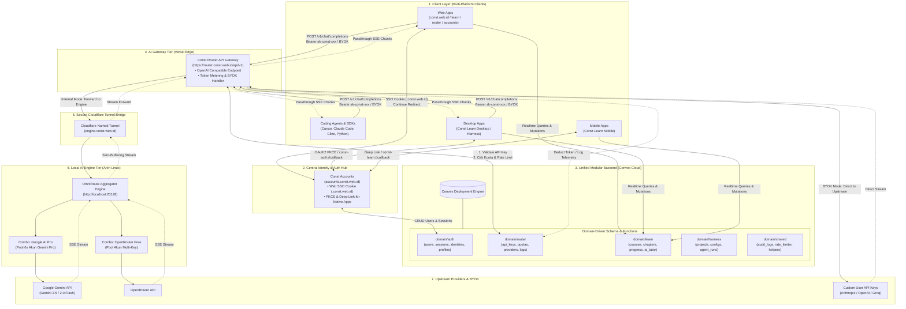
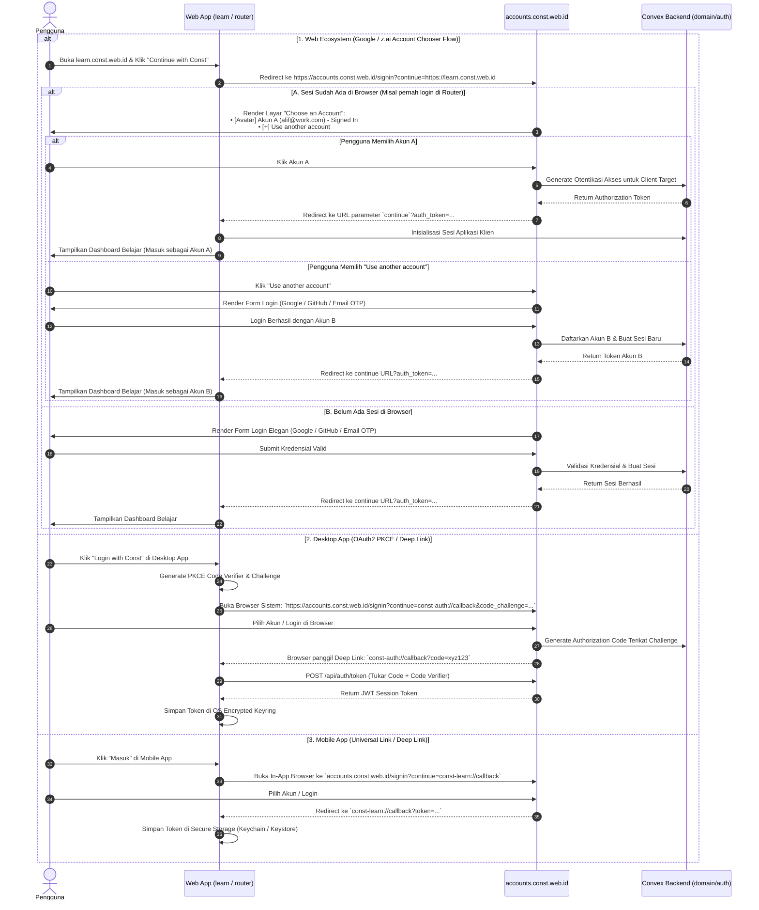
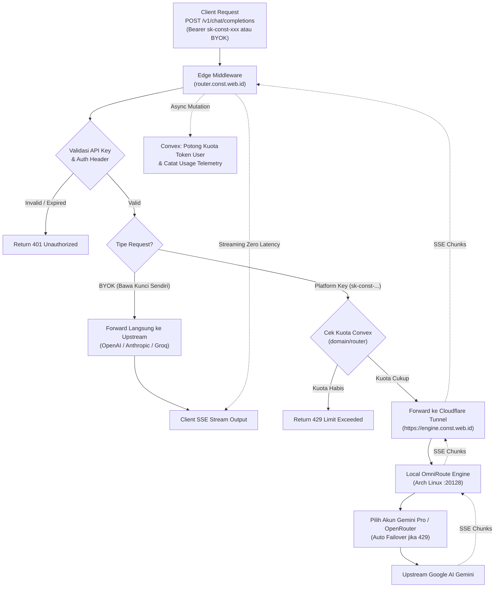
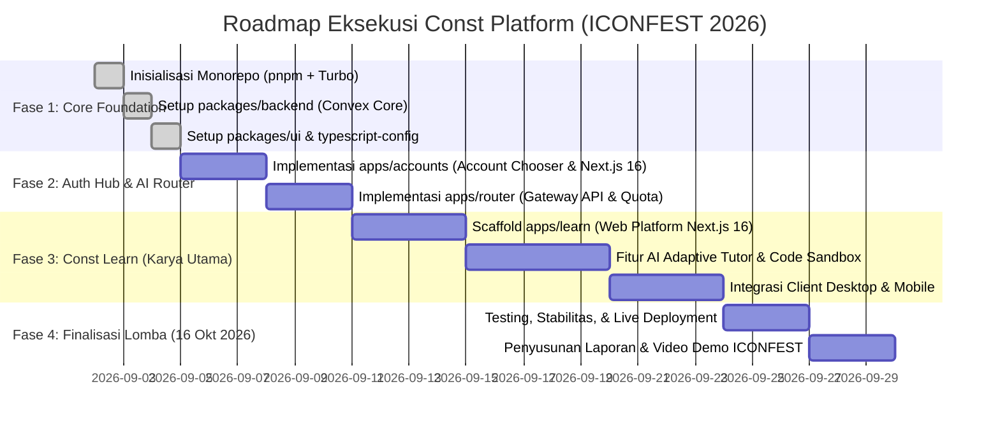

# Arsitektur Sistem: Const Platform Ecosystem

Dokumen ini merupakan cetak biru (*master blueprint*) arsitektur terpadu, topologi sistem, spesifikasi modular monorepo, arsitektur backend Convex berbasis domain (*Domain-Driven Design*), mekanisme otentikasi terpusat (SSO Multi-Platform), AI Gateway (BYOK & Multi-Provider), serta strategi kompetisi **ICONFEST 2026 (Software Development - Tema Pendidikan)** untuk ekosistem **Const Platform**.

---

## 1. Ringkasan Eksekutif & Visi Ekosistem

**Const Platform** adalah ekosistem digital modern terpadu berbasis **Monorepo (Turborepo + pnpm)** yang dirancang dengan prinsip arsitektur tingkat *enterprise* (*Scalable, Maintainable, Type-Safe, & Modular*). 

Ekosistem ini terdiri dari beberapa pilar utama:
1. **Const Accounts (`accounts.const.web.id`):** Identity Provider & Central Auth Hub terpusat yang melayani Web SSO (Cross-Subdomain Cookie), Desktop App (OAuth2 PKCE / Deep Link), dan Mobile App.
2. **Const Router (`router.const.web.id`):** AI Gateway independen berperforma tinggi yang kompatibel dengan standar OpenAI API. Mendukung multi-provider, token metering, rate limiting, serta fitur **BYOK (Bring Your Own Key)** dan integrasi ke local engine (OmniRoute).
3. **Const Engine (`engine.const.web.id`):** Local aggregator tier (OmniRoute di Arch Linux) yang menghubungkan multi-akun AI (6x Google Gemini Pro + OpenRouter) melalui Cloudflare Tunnel berkecepatan tinggi.
4. **Const Learn (`learn.const.web.id` + Desktop/Mobile):** Platform edukasi adaptif berbasis AI interaktif (**Karya Utama ICONFEST 2026 - Tema Pendidikan**).
5. **Const Landing (`const.web.id`):** Portal showcase dan navigasi publik ekosistem.
6. **Const Harness (`harness.const.web.id` + Desktop):** Platform *developer tools* dan *agentic workbench* di masa depan.

Seluruh data dan logika bisnis dipusatkan pada **Single Unified Modular Backend (Convex)** dengan arsitektur sub-folder modular (*Domain-Driven Architecture*) untuk mencegah tumpukan file (*flat anti-pattern*) serta menjamin sinkronisasi data *real-time* instan dan *end-to-end type-safety*.

---

## 2. Topologi & Diagram Arsitektur Terpadu



---

## 3. Struktur Monorepo Terstandar (Turborepo + pnpm)

Monorepo diorganisasikan dengan prinsip **Separation of Concerns (SoC)** dan **High Reusability**:

```text
Const/
├── package.json                      # Root scripts (build, dev, lint, test)
├── pnpm-workspace.yaml               # Definisi workspace packages & apps
├── turbo.json                        # Turborepo task pipeline & caching rules
├── .gitignore
├── README.md
├── arsitektur.md                     # Dokumen master blueprint arsitektur sistem
│
├── packages/                         # Shared Packages (Modul yang dapat dipakai ulang)
│   ├── backend/                      # Single Unified Convex Backend (Modular Architecture)
│   │   ├── package.json
│   │   ├── tsconfig.json
│   │   └── convex/
│   │       ├── schema.ts             # Root schema aggregator
│   │       ├── schema/               # Definisi tabel terpisah per domain
│   │       │   ├── auth.ts           # Schema: users, sessions, profiles, accounts
│   │       │   ├── router.ts         # Schema: api_keys, token_quotas, byok_configs, usage_logs
│   │       │   ├── learn.ts          # Schema: courses, modules, lessons, user_progress, submissions
│   │       │   └── harness.ts        # Schema: harness_workspaces, configs
│   │       ├── auth/                 # Business logic & mutasi Auth Hub
│   │       │   ├── actions.ts        # OAuth external handlers
│   │       │   ├── mutations.ts      # User register, login, session creation
│   │       │   └── queries.ts        # getUser, validateSession, checkRedirect
│   │       ├── router/               # Business logic & mutasi AI Gateway
│   │       │   ├── keys.ts           # API Key creation (sk-const-xxx), revoke, list
│   │       │   ├── quotas.ts         # Token deduct, rate limit checker
│   │       │   └── telemetry.ts      # Usage history & cost metrics
│   │       ├── learn/                # Business logic EduTech (ICONFEST 2026 Core)
│   │       │   ├── courses.ts        # Course & module queries
│   │       │   ├── progress.ts       # Track milestones, quiz submissions
│   │       │   └── tutor.ts          # AI interactive learning feedback & hints
│   │       ├── harness/              # Workbench functions
│   │       │   └── workspaces.ts
│   │       ├── shared/               # Shared backend utilities
│   │       │   ├── rateLimiter.ts
│   │       │   ├── permissions.ts
│   │       │   └── validators.ts
│   │       └── _generated/           # Auto-generated typed API definitions
│   │
│   ├── ui/                           # Const Design System (Shared Component Library)
│   │   ├── package.json
│   │   ├── tsconfig.json
│   │   ├── src/
│   │   │   ├── components/           # Radix / shadcn/ui (Button, Input, Card, Modal, Table, etc.)
│   │   │   ├── layout/               # Header, Navbar, Footer, UserMenu, EcosystemDrawer
│   │   │   ├── theme/                # ThemeProvider (Dark/Light/System)
│   │   │   └── lib/                  # cn, cva, utils
│   │   └── tailwind.config.ts        # Shared Tailwind preset
│   │
│   ├── typescript-config/            # Base TSConfig (@const/typescript-config: base, nextjs, react-library)
│   │   ├── package.json
│   │   ├── base.json
│   │   ├── nextjs.json
│   │   └── react-library.json
│   │
│   └── (Catatan: @const/types ditiadakan karena Convex menyediakan End-to-End Type Safety otomatis
│        langsung via `convex/_generated/`, mencegah duplikasi dan over-engineering)
│
└── apps/                             # Deployable Applications (Next.js 16 App Router)
    ├── accounts/                     # accounts.const.web.id (Central Auth & Account Chooser Hub)
    │   ├── package.json
    │   ├── next.config.ts
    │   └── src/                      # Next.js 16 App Router (Account Chooser, Login, OAuth, SSO Callback)
    │
    ├── router/                       # router.const.web.id (AI Gateway API & Dashboard)
    │   ├── package.json
    │   ├── next.config.ts
    │   └── src/                      # API /v1/chat/completions + Dashboard API Key Management
    │
    ├── learn/                        # learn.const.web.id (ICONFEST 2026 EduTech Showcase)
    │   ├── package.json
    │   ├── next.config.ts
    │   └── src/                      # Interactive courses, AI coding sandbox, quiz assessments
    │
    ├── landing/                      # const.web.id (Ecosystem Landing & Showcase)
    │   ├── package.json
    │   └── src/                      # High-converting landing page, product documentation
    │
    └── harness/                      # harness.const.web.id (Desktop & Web Dev Workbench)
        ├── package.json
        └── src/
```

---

## 4. Perbandingan Desain Backend: Flat Anti-Pattern vs Domain-Driven Subdirectories

### A. Masalah pada "Flat Structure" (Anti-Pattern):
Pada implementasi Convex standar yang menaruh seluruh file secara datar (*flat*) di root folder `convex/` (misalnya: `budget.ts`, `chats.ts`, `files.ts`, `knowledge.ts`, `messages.ts`, `notes.ts`, `tasks.ts`, `users.ts`):
* **Cluttering Ekstrem:** Saat ekosistem berkembang dengan modul Auth, AI Router, Learn, dan Harness, folder `convex/` akan dipenuhi **40–60 file sekaligus** di satu direktori.
* **Risiko Tabrakan Nama (*Name Collisions*):** Kebingungan fungsi seperti `messages.ts` (apakah untuk AI Router atau forum diskusi di Learn?).
* **Maintainability Rendah:** Sulit bagi tim atau juri lomba untuk membedakan batas fungsionalitas antar-produk.

### B. Solusi: Arsitektur Sub-Folder Modular di Convex
Convex secara *native* mendukung pemetaan rute fungsi bertingkat berdasarkan nama sub-folder.

```text
packages/backend/convex/
├── _generated/
├── schema.ts                <-- Menggabungkan seluruh tabel domain
│
├── schema/                  <-- [FOLDER] Skema tabel terisolasi per domain
│   ├── auth.ts              <-- users, sessions, accounts, verifications
│   ├── router.ts            <-- api_keys, token_usage, byok_configs, request_logs
│   ├── learn.ts             <-- courses, chapters, user_progress, submissions
│   └── harness.ts           <-- harness_projects, configs, agent_runs
│
├── auth/                    <-- [FOLDER] Logika & Mutasi Auth Hub (accounts.const.web.id)
│   ├── queries.ts
│   ├── mutations.ts
│   └── actions.ts
│
├── router/                  <-- [FOLDER] Logika & Mutasi AI Gateway (router.const.web.id)
│   ├── keys.ts
│   ├── quotas.ts
│   └── telemetry.ts
│
├── learn/                   <-- [FOLDER] Logika & Mutasi EduTech (learn.const.web.id)
│   ├── courses.ts
│   ├── progress.ts
│   └── tutor.ts
│
└── harness/                 <-- [FOLDER] Logika & Mutasi Workbench (harness.const.web.id)
    └── workspaces.ts
```

### C. Implementasi Kode Skema Modular

#### 1. File Skema Domain (`convex/schema/auth.ts`):
```typescript
import { defineTable } from "convex/server";
import { v } from "convex/values";

export const authTables = {
  users: defineTable({
    name: v.string(),
    email: v.string(),
    image: v.optional(v.string()),
    role: v.union(v.literal("user"), v.literal("admin")),
    createdAt: v.number(),
  }).index("by_email", ["email"]),

  sessions: defineTable({
    userId: v.id("users"),
    token: v.string(),
    expiresAt: v.number(),
    userAgent: v.optional(v.string()),
  }).index("by_token", ["token"]),
};
```

#### 2. File Skema Domain AI Router (`convex/schema/router.ts`):
```typescript
import { defineTable } from "convex/server";
import { v } from "convex/values";

export const routerTables = {
  apiKeys: defineTable({
    userId: v.id("users"),
    name: v.string(),
    keyHash: v.string(),
    keyPrefix: v.string(), // sk-const-xxxx
    dailyLimitTokens: v.number(),
    usedTodayTokens: v.number(),
    status: v.union(v.literal("active"), v.literal("revoked")),
    createdAt: v.number(),
  }).index("by_user", ["userId"]).index("by_key_hash", ["keyHash"]),

  byokConfigs: defineTable({
    userId: v.id("users"),
    provider: v.union(v.literal("openai"), v.literal("anthropic"), v.literal("google"), v.literal("groq")),
    encryptedKey: v.string(),
    customEndpoint: v.optional(v.string()),
  }).index("by_user_provider", ["userId", "provider"]),
};
```

#### 3. File Utama Penggabung (`convex/schema.ts`):
```typescript
import { defineSchema } from "convex/server";
import { authTables } from "./schema/auth";
import { routerTables } from "./schema/router";
import { learnTables } from "./schema/learn";
import { harnessTables } from "./schema/harness";

export default defineSchema({
  ...authTables,
  ...routerTables,
  ...learnTables,
  ...harnessTables,
});
```

#### 4. Pemanggilan di Frontend Client (Type-Safe & Auto-Completed):
```typescript
// Di apps/accounts (Auth Hub)
import { api } from "@const/backend/_generated/api";
const user = useQuery(api.auth.queries.getUser);

// Di apps/router (AI Gateway)
const userKeys = useQuery(api.router.keys.listKeys);

// Di apps/learn (ICONFEST 2026 Platform Belajar)
const courseCatalog = useQuery(api.learn.courses.getCourses);
const submitQuiz = useMutation(api.learn.progress.submitQuiz);
```

---

## 5. Arsitektur Detail: Const Accounts (`accounts.const.web.id`)

### A. Peran & Filosofi Desain: "Google / z.ai Account Chooser Pattern"
`accounts.const.web.id` berfungsi sebagai **Central Identity Provider (IdP)** tunggal bagi seluruh ekosistem Const. 

Berbeda dengan sistem SSO tradisional yang memaksakan *silent/implicit login* (otomatis login diam-diam dengan sesi sebelumnya), Const Accounts mengadopsi model **Account Chooser (seperti Google & z.ai)**:
1. **Multi-Account Awareness:** Pengguna sering memiliki peran berbeda (misal: akun developer/kantor di `router.const.web.id` dan akun pribadi/pelajar di `learn.const.web.id`). Sistem tidak otomatis memaksakan akun yang sedang aktif di browser jika pengguna membuka aplikasi baru.
2. **Explicit User Consent & Account Switching:** Saat pengguna mengeklik *"Continue with Const"* di klien mana pun, `accounts.const.web.id` akan memeriksa sesi yang tersimpan di peramban dan menampilkan antarmuka pemilihan akun:
   * **Pilih Akun Tersimpan:** Menampilkan daftar akun yang sedang aktif (Avatar, Nama, Email) — sekali klik untuk langsung masuk sebagai akun tersebut.
   * **Use Another Account:** Memberikan opsi untuk login dengan akun baru (Google / GitHub / Email OTP) tanpa harus me-logout akun yang sudah ada.
3. **Pemisahan Konteks Antar-Aplikasi:** Menghindari insiden salah akun atau tercampurnya kuota API AI dan progres belajar.

### B. Multi-Platform Authentication Strategy & Alur Interaksi



### C. Keamanan & Proteksi Auth Hub
1. **Open-Redirect Protection (Whitelist Validation):**
   * Parameter `continue` divalidasi secara ketat di sisi server.
   * Hanya mengizinkan target URL dengan pattern:
     - `https://*.const.web.id/*`
     - `http://localhost:*/*` (khusus mode development)
     - `const-auth://*` (Desktop Protocol)
     - `const-learn://*` (Mobile Protocol)
   * Jika parameter `continue` tidak valid atau mengarah ke domain luar, aplikasi otomatis me-redirect user ke dashboard profil utama `accounts.const.web.id`.
2. **Session Hijacking & CSRF Defense:**
   * Cookie session menggunakan flag `HttpOnly`, `Secure`, dan `SameSite=Lax`.
   * State parameter acak (anti-CSRF) digunakan pada semua flow OAuth eksternal (Google/GitHub).
3. **Granular Session Invalidation:**
   * Pengguna dapat me-logout akun tertentu dari peramban tanpa memengaruhi akun lainnya (*Selective Account Sign-out*).

---

## 6. Arsitektur Detail: Const Router (`router.const.web.id`)

### A. Peran & Tanggung Jawab
`router.const.web.id` bertindak sebagai **Universal AI Gateway** yang mengabstraksi berbagai model AI di belakang satu antarmuka standar OpenAI (`/v1/chat/completions` dan `/v1/models`).

### B. Fitur Unggulan (Core Capabilities):
1. **BYOK (Bring Your Own Key) & Custom Providers:**
   * User dapat memasukkan API Key milik mereka sendiri (OpenAI, Anthropic, Gemini, Groq) di dashboard Router.
   * Saat memanggil API dengan header `X-Provider: openai` dan `X-API-Key: sk-user-...`, Router akan meneruskan request langsung ke provider terkait tanpa memotong kuota platform.
2. **Platform Managed Pool (Local OmniRoute via Tunnel):**
   * Untuk pengguna standar dan platform `Const Learn`, Router meneruskan request ke `engine.const.web.id` (OmniRoute di Arch Linux) yang mengelola *pool* multi-akun Gemini Pro.
3. **Token Metering & Quota Enforcement:**
   * Setiap API Key `sk-const-xxx` memiliki batasan kuota (Harian / Bulanan / Tier).
   * Middleware Edge Runtime di Router memeriksa sisa kuota ke Convex Backend sebelum melakukan *dispatch* ke upstream AI.
4. **Zero-Buffering SSE Streaming:**
   * Menggunakan `ReadableStream` murni di Next.js Edge Runtime untuk mengalirkan potongan kata (*chunks*) secara *real-time* ke klien tanpa latensi tambahan.

### C. Alur Request Lifecycle Const Router



---

## 7. Roadmap Eksekusi Bertahap



- [x] **Fase 1.1: Local Engine & Network Bridge** (Cloudflare Tunnel `engine.const.web.id` terhubung ke OmniRoute di Arch Linux).
- [x] **Fase 1.2: Inisialisasi Monorepo & Backend Core** (Turborepo + pnpm + Convex Clean Core).
- [x] **Fase 1.3: Shared Packages** (`@const/ui` dengan 55 komponen shadcn & ThemeProvider, `@const/typescript-config`).
- [ ] **Fase 2.1: Const Accounts App** (`accounts.const.web.id` dengan Google / z.ai Account Chooser Pattern & Next.js 16).
- [ ] **Fase 2.2: Const Router Gateway** (`router.const.web.id` dengan BYOK, Quota Tracking di Convex, & SSE Streaming).
- [ ] **Fase 3: Const Learn Development** (`learn.const.web.id` - Pembuatan platform edukasi interaktif untuk ICONFEST 2026).
- [ ] **Fase 4: Finalisasi Dokumen & Video ICONFEST 2026** (Laporan penyisihan, video demo 75% progress, dan deployment).
